# Medições do SLA · Testes de carga do Ecoturismo Rio

Medições de **latência**, **vazão** e **concorrência** de três serviços da API do Ecoturismo Rio, feitas com o [k6](https://grafana.com/docs/k6/latest/).

- **Medição 1:** o sistema como está, para achar os gargalos.
- **Medição 2:** depois das otimizações, comparando com a medição 1.

[Serviço 1 · Busca no catálogo de trilhas](#serviço-1--busca-no-catálogo-de-trilhas) · [Serviço 2 · Planejar e cancelar visita](#serviço-2--planejar-e-cancelar-visita) · [Serviço 3 · Login](#serviço-3--login) · [Comparação entre os serviços](#comparação-entre-os-serviços) · [Como rodar](#como-rodar)

## Como os testes foram feitos

- **Ferramenta:** k6. Cada serviço tem o seu script, e todos usam o mesmo perfil de carga
  ([`degraus.js`](../tests/k6/sla/lib/degraus.js)), para dar para comparar um serviço com o outro.
- **Concorrência:** o número de usuários virtuais (VUs) simultâneos sobe em patamares de **10, 25, 50, 100, 150 e 200**,
  com 10 s de subida e 50 s parado em cada patamar (cerca de 6 min e meio por serviço).
  Os VUs **não fazem pausa**: cada um manda a próxima requisição assim que recebe a resposta, então *N VUs = N requisições simultâneas*.
- **Latência:** tempo de resposta (`http_req_duration`): média, P95 e P99 de cada patamar e evolução segundo a segundo.
- **Vazão:** requisições atendidas por segundo (média de cada patamar e evolução segundo a segundo).
- **Limite de concorrência:** o maior patamar em que o SLA ainda vale, antes do primeiro patamar que o quebra.
- **SLA usado:** P95 de até **500 ms** na busca e nas visitas e de até **1000 ms** no login (o BCrypt deixa o login lento de propósito),
  com **menos de 1% de erros** em todos.
- **Só o patamar conta:** as requisições feitas durante a subida de um patamar para o outro aparecem nos gráficos no tempo,
  mas ficam fora das tabelas por patamar.
- **Massa de dados:** as 46 trilhas da migração [`V2__trilhas.sql`](../backend/src/main/resources/db/migration/V2__trilhas.sql)
  e as contas de teste do [`DataSeeder`](../backend/src/main/java/br/com/ecoturismo/config/DataSeeder.java).
  O teste de visitas cadastra antes um usuário por VU (e-mails `@carga.test`), para cada VU gravar as próprias visitas.
- **Gráficos:** gerados pelo [`graficos.py`](../tests/k6/sla/graficos.py) a partir do CSV do k6.

### Configuração do ambiente

<!-- AMBIENTE -->
| Item | Valor |
| --- | --- |
| Onde rodou | computador local |
| Computador | AMD Ryzen 7 7800X3D 8-Core Processor (16 núcleos lógicos) · 32 GB de RAM |
| Sistema operacional | Microsoft Windows 10 Pro |
| Back-end | Spring Boot 3.3 (jar) em Java 25.0.3, Tomcat embutido (padrão: até 200 threads) e pool HikariCP (padrão: 10 conexões) |
| Banco de dados | MySQL 8.0.45 |
| Gerador de carga | k6 v2.4.0, na mesma máquina, em `http://localhost:8080` |
| Perfil de carga | patamares de 10, 25, 50, 100, 150, 200 VUs; 10 s de subida e 50 s parado em cada |
<!-- /AMBIENTE -->

Backend, banco e k6 rodam na mesma máquina e disputam CPU e memória: nos patamares altos, parte do tempo medido pode ser essa disputa.

A única diferença de ambiente entre as medições é o MySQL: na medição 1 com o `my.ini` padrão do instalador e, na medição 2, com o redo log
e o buffer pool aumentados para 1 GB ([`ajustes-mysql.sql`](../tests/k6/sla/ajustes-mysql.sql)).

### Arquivos com o código fonte da medição do SLA

- [`lib/degraus.js`](../tests/k6/sla/lib/degraus.js): perfil de carga e SLA comuns aos três serviços
- [`busca-trilhas.js`](../tests/k6/sla/busca-trilhas.js), [`visitas.js`](../tests/k6/sla/visitas.js), [`login.js`](../tests/k6/sla/login.js): um script por serviço
- [`rodar-testes.bat`](../tests/k6/sla/rodar-testes.bat): roda os três serviços e gera os gráficos (Windows)
- [`graficos.py`](../tests/k6/sla/graficos.py): gráficos, tabelas e as partes desta página entre marcadores
- [`limpar-dados-de-carga.sql`](../tests/k6/sla/limpar-dados-de-carga.sql): apaga os usuários e as visitas criados pelo teste
- [`ajustes-mysql.sql`](../tests/k6/sla/ajustes-mysql.sql): ajustes do MySQL usados na medição 2
- [`sla-k6.yml`](../.github/workflows/sla-k6.yml): a mesma medição no GitHub Actions

---

## Serviço 1 · Busca no catálogo de trilhas

- **Endpoint:** `GET /api/trilhas?q=&dificuldade=&zona=&duracao=`
- **Tipo de operações:** leitura (página "Trilhas": o visitante digita um texto e escolhe filtros; não precisa de login).
  Cada VU faz buscas seguidas com filtros sorteados.
- **Arquivos envolvidos:**
  [`TrilhaController.java`](../backend/src/main/java/br/com/ecoturismo/trilha/TrilhaController.java) ·
  [`TrilhaService.java`](../backend/src/main/java/br/com/ecoturismo/trilha/TrilhaService.java) ·
  [`TrilhaRepository.java`](../backend/src/main/java/br/com/ecoturismo/trilha/TrilhaRepository.java) ·
  [`Trilha.java`](../backend/src/main/java/br/com/ecoturismo/trilha/Trilha.java) ·
  [`ImagemTrilha.java`](../backend/src/main/java/br/com/ecoturismo/trilha/ImagemTrilha.java) ·
  [`TrilhaResponse.java`](../backend/src/main/java/br/com/ecoturismo/trilha/dto/TrilhaResponse.java) ·
  [`FaixaDuracao.java`](../backend/src/main/java/br/com/ecoturismo/trilha/dto/FaixaDuracao.java) ·
  [`SecurityConfig.java`](../backend/src/main/java/br/com/ecoturismo/security/SecurityConfig.java) ·
  [`V1__criar_tabelas.sql`](../backend/src/main/resources/db/migration/V1__criar_tabelas.sql) (tabelas `TRILHA` e `TRILHA_IMAGEM`) ·
  [`Trails.jsx`](../frontend/src/pages/Trails.jsx)
- **Arquivos com o código fonte de medição do SLA:**
  [`busca-trilhas.js`](../tests/k6/sla/busca-trilhas.js) ·
  [`degraus.js`](../tests/k6/sla/lib/degraus.js) ·
  [`graficos.py`](../tests/k6/sla/graficos.py) ·
  [`rodar-testes.bat`](../tests/k6/sla/rodar-testes.bat) ·
  [`sla-k6.yml`](../.github/workflows/sla-k6.yml)

### Medição 1

<!-- MEDICAO1:busca-trilhas -->
- **Data da medição:** 16/11/2026
- **Descrição das configurações:** computador local: AMD Ryzen 7 7800X3D 8-Core Processor, 16 núcleos lógicos, 32 GB de RAM, Microsoft Windows 10 Pro. Backend (Spring Boot), banco e gerador de carga na mesma máquina, sem containers (Java 25.0.3 · MySQL 8.0.45 · k6 v2.4.0). Detalhes em [Configuração do ambiente](#configuração-do-ambiente).

#### Testes de carga (SLA): latência, vazão e concorrência

- **Requisições no teste:** 430.139
- **Limite de concorrência dentro do SLA** (p95 ≤ 500 ms e erros < 1%): o SLA valeu em todos os patamares, até **200 VUs** (o limite real fica acima disso)

| Concorrência (VUs) | Requisições | Latência média (ms) | p95 (ms) | p99 (ms) | Vazão (req/s) | Erros (%) | SLA |
| ---: | ---: | ---: | ---: | ---: | ---: | ---: | :---: |
| 10 | 57.063 | 8,62 | 9,80 | 12,01 | 1.141,4 | 0,00 | ✅ |
| 25 | 58.842 | 21,02 | 24,20 | 32,58 | 1.176,9 | 0,00 | ✅ |
| 50 | 59.794 | 41,64 | 44,41 | 74,75 | 1.194,7 | 0,00 | ✅ |
| 100 | 59.123 | 84,39 | 92,86 | 163,23 | 1.176,2 | 0,00 | ✅ |
| 150 | 58.447 | 128,05 | 141,44 | 253,46 | 1.163,9 | 0,00 | ✅ |
| 200 | 60.011 | 166,48 | 178,35 | 323,33 | 1.194,2 | 0,00 | ✅ |

| Métrica (teste inteiro) | Média | Mediana | Mín | Máx | P95 | P99 |
| --- | ---: | ---: | ---: | ---: | ---: | ---: |
| Latência, `http_req_duration` (ms) | 74,42 | 52,07 | 6,02 | 693,01 | 166,16 | 181,86 |
| Tempo bloqueado, `http_req_blocked` (ms) | 0,01 | 0,00 | 0,00 | 41,60 | 0,00 | 0,50 |

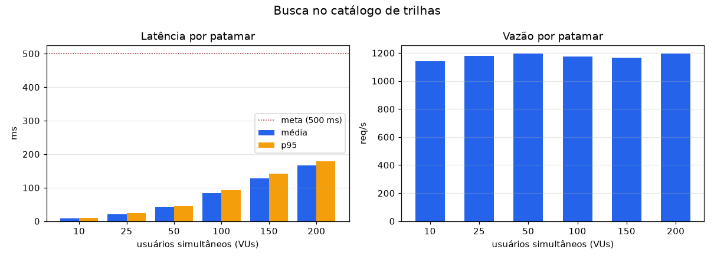
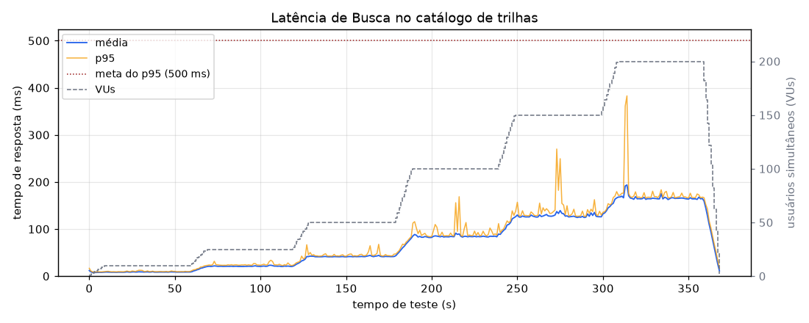
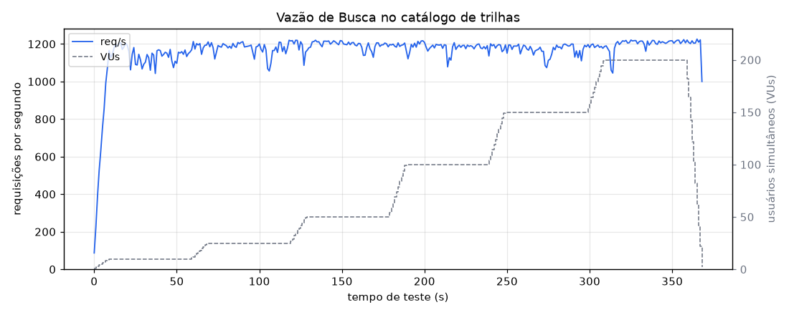
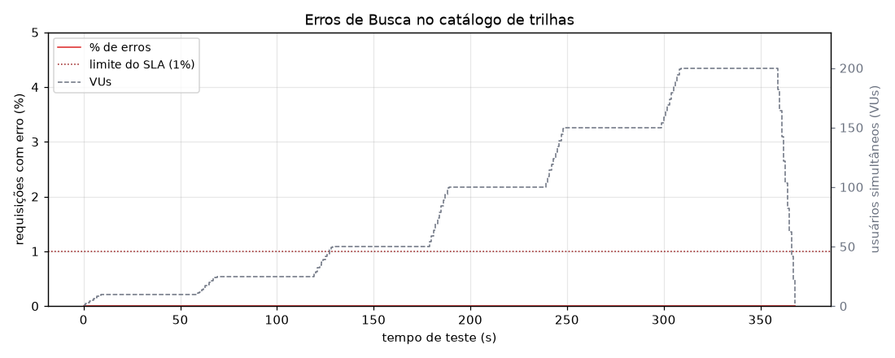
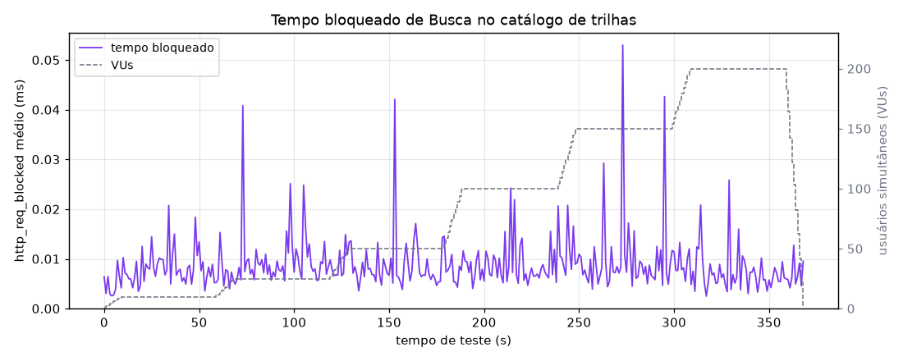

**Resumo dos números**

- De 10 para 200 VUs, a latência média foi de 8,62 ms para 166,48 ms, o p95 de 9,80 ms para 178,35 ms e a vazão de 1.141,4 para 1.194,2 req/s.
- A vazão chegou a 90% do máximo (1.194,7 req/s) já com 10 VUs. Daí em diante, mais usuários só aumentaram o tempo de espera: algum recurso (CPU, conexões com o banco ou threads) está no limite e as requisições fazem fila.
- O SLA foi cumprido em todos os patamares.
- Nenhuma requisição falhou.
- Números completos: [`busca-trilhas-patamares.csv`](sla/medicao-1/busca-trilhas-patamares.csv) e [`busca-trilhas-por-segundo.csv`](sla/medicao-1/busca-trilhas-por-segundo.csv).
<!-- /MEDICAO1:busca-trilhas -->

#### Levantamento de hipóteses dos potenciais gargalos

- **O que a medição mostrou:** sem erros e dentro do SLA até 200 VUs, mas a vazão já estava no máximo com 10 VUs (cerca de 1.140 a 1.195 req/s
  em todos os patamares). Daí em diante, cada VU a mais só aumentou a fila: a latência média cresceu na mesma proporção dos VUs
  (8,62 ms com 10 e 166,48 ms com 200, ou seja, 200 ÷ 1.194 req/s). O SLA vale com folga porque cada busca é rápida; pela tendência do p95
  (cerca de 0,9 ms a mais por VU), a meta de 500 ms seria atingida perto de 550 VUs. Os picos isolados de p95 (até cerca de 380 ms) aparecem
  sem mudança de VUs e provavelmente são pausas do coletor de lixo do Java.
- **Pool de conexões e consultas N+1:** a vazão parou de crescer exatamente com 10 VUs, que é o tamanho do pool do HikariCP. `Trilha.imagens`
  é `@ElementCollection(fetch = EAGER)`, então o Hibernate faz 1 consulta para as trilhas e mais 1 em `TRILHA_IMAGEM` para cada trilha
  (cerca de 47 consultas por busca), e a requisição segura a conexão durante todas elas. Com 10 conexões, no máximo 10 buscas andam ao mesmo tempo.
- **Catálogo inteiro a cada requisição:** `TrilhaService.buscar()` chama `repository.findAll()` e só depois filtra em memória.
  Qualquer busca, mesmo a mais restrita, lê as 46 trilhas do banco: o custo cresce com o tamanho do catálogo, não com o resultado.
- **CPU na normalização do texto:** em cada requisição, nome, localização, zona e parque de cada trilha passam por `Normalizer.normalize`
  e uma expressão regular (para buscar sem acento).
- **Resposta pesada:** `TrilhaResponse` devolve a descrição completa, "como chegar" e a lista de imagens de todas as trilhas encontradas;
  a serialização em JSON pesa mais que a consulta quando a busca é ampla.
- **Sem cache:** o catálogo quase nunca muda, mas toda busca vai ao banco.

### Medição 2

<!-- MEDICAO2:busca-trilhas -->
- **Data da medição:** 16/11/2026
- **Descrição das configurações:** computador local: AMD Ryzen 7 7800X3D 8-Core Processor, 16 núcleos lógicos, 32 GB de RAM, Microsoft Windows 10 Pro. Backend (Spring Boot), banco e gerador de carga na mesma máquina, sem containers (Java 25.0.3 · MySQL 8.0.45 · k6 v2.4.0). Detalhes em [Configuração do ambiente](#configuração-do-ambiente).

#### Testes de carga (SLA): latência, vazão e concorrência

- **Requisições no teste:** 14.294.816
- **Limite de concorrência dentro do SLA** (p95 ≤ 500 ms e erros < 1%): o SLA valeu em todos os patamares, até **200 VUs** (o limite real fica acima disso)

| Concorrência (VUs) | Requisições | Latência média (ms) | p95 (ms) | p99 (ms) | Vazão (req/s) | Erros (%) | SLA |
| ---: | ---: | ---: | ---: | ---: | ---: | ---: | :---: |
| 10 | 1.699.174 | 0,19 | 1,00 | 1,03 | 33.984,2 | 0,00 | ✅ |
| 25 | 2.220.415 | 0,40 | 1,00 | 2,00 | 44.407,4 | 0,00 | ✅ |
| 50 | 2.237.549 | 0,93 | 2,42 | 4,00 | 44.749,2 | 0,00 | ✅ |
| 100 | 2.089.389 | 2,08 | 4,51 | 8,00 | 41.784,4 | 0,00 | ✅ |
| 150 | 1.894.334 | 3,06 | 7,00 | 11,51 | 37.882,9 | 0,00 | ✅ |
| 200 | 1.454.995 | 5,02 | 10,78 | 17,49 | 29.096,4 | 0,00 | ✅ |

| Métrica (teste inteiro) | Média | Mediana | Mín | Máx | P95 | P99 |
| --- | ---: | ---: | ---: | ---: | ---: | ---: |
| Latência, `http_req_duration` (ms) | 1,75 | 1,00 | 0,00 | 2.002,53 | 5,50 | 10,01 |
| Tempo bloqueado, `http_req_blocked` (ms) | 0,02 | 0,00 | 0,00 | 1.139,21 | 0,00 | 0,00 |

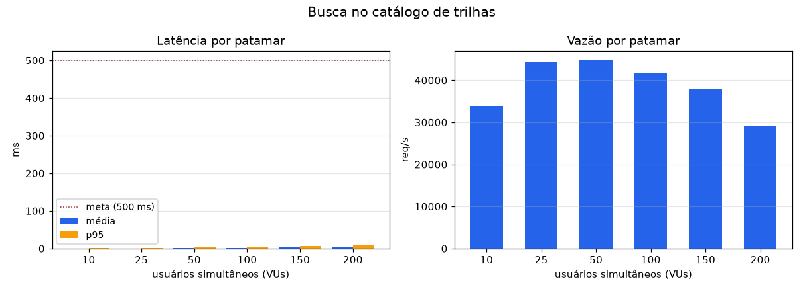
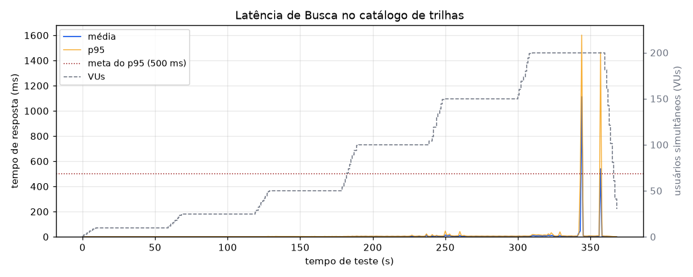
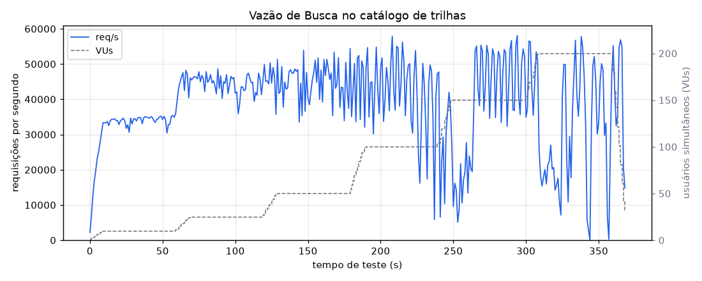

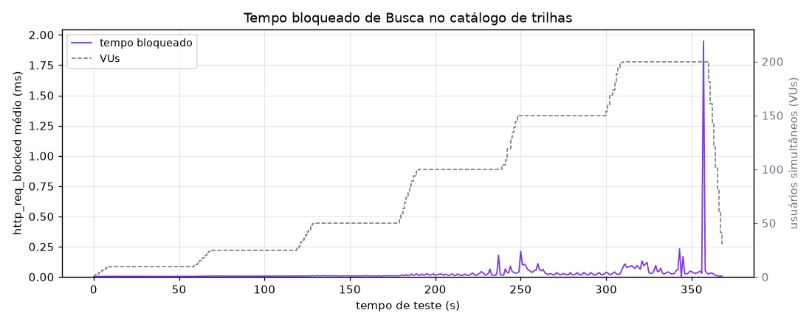

**Resumo dos números**

- De 10 para 200 VUs, a latência média foi de 0,19 ms para 5,02 ms, o p95 de 1,00 ms para 10,78 ms e a vazão de 33.984,2 para 29.096,4 req/s.
- A vazão foi máxima com 50 VUs (44.749,2 req/s) e depois caiu para 29.096,4 req/s com 200 VUs: além de fazer fila, o serviço ficou mais lento ao longo do teste (veja o gráfico de vazão no tempo).
- O SLA foi cumprido em todos os patamares.
- Nenhuma requisição falhou.
- Números completos: [`busca-trilhas-patamares.csv`](sla/medicao-2/busca-trilhas-patamares.csv) e [`busca-trilhas-por-segundo.csv`](sla/medicao-2/busca-trilhas-por-segundo.csv).
<!-- /MEDICAO2:busca-trilhas -->

<!-- COMPARACAO:busca-trilhas -->
| Concorrência (VUs) | Latência média 1 → 2 (ms) | p95 1 → 2 (ms) | Vazão 1 → 2 (req/s) | Erros 1 → 2 (%) |
| ---: | ---: | ---: | ---: | ---: |
| 10 | 8,62 → 0,19 (-97,8%) | 9,80 → 1,00 (-89,8%) | 1.141,4 → 33.984,2 (+2.877,4%) | 0,00 → 0,00 |
| 25 | 21,02 → 0,40 (-98,1%) | 24,20 → 1,00 (-95,9%) | 1.176,9 → 44.407,4 (+3.673,3%) | 0,00 → 0,00 |
| 50 | 41,64 → 0,93 (-97,8%) | 44,41 → 2,42 (-94,5%) | 1.194,7 → 44.749,2 (+3.645,8%) | 0,00 → 0,00 |
| 100 | 84,39 → 2,08 (-97,5%) | 92,86 → 4,51 (-95,1%) | 1.176,2 → 41.784,4 (+3.452,4%) | 0,00 → 0,00 |
| 150 | 128,05 → 3,06 (-97,6%) | 141,44 → 7,00 (-95,0%) | 1.163,9 → 37.882,9 (+3.154,7%) | 0,00 → 0,00 |
| 200 | 166,48 → 5,02 (-97,0%) | 178,35 → 10,78 (-94,0%) | 1.194,2 → 29.096,4 (+2.336,4%) | 0,00 → 0,00 |

- **Limite de concorrência dentro do SLA:** 200 VUs na medição 1 → 200 VUs na medição 2.
- **Latência média do teste inteiro:** 74,42 ms → 1,75 ms (-97,7%).

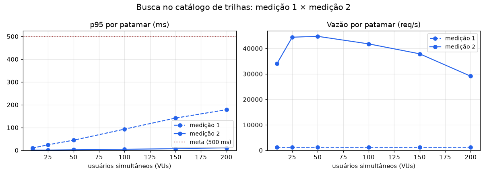
<!-- /COMPARACAO:busca-trilhas -->

**Melhorias/otimizações:**

- [`TrilhaService.java`](../backend/src/main/java/br/com/ecoturismo/trilha/TrilhaService.java): o catálogo fica **em memória**.
  Na primeira busca as trilhas são lidas do banco uma vez, já com o texto de busca normalizado (sem acento) e a `TrilhaResponse` pronta;
  as buscas seguintes só filtram essa lista, sem abrir transação nem pegar conexão do pool. Quando um administrador cria, edita ou
  remove uma trilha, o catálogo é descartado depois do commit e é montado de novo na busca seguinte.
  `garantirQueExiste()` (usado ao planejar uma visita) também passou a consultar o catálogo em memória.
- [`TrilhaRepository.java`](../backend/src/main/java/br/com/ecoturismo/trilha/TrilhaRepository.java): nova consulta `findAllComImagens()`,
  com `left join fetch` nas imagens, que lê trilhas e imagens numa consulta só em vez de 1 + 46 (fim do N+1).
- [`TrilhaController.java`](../backend/src/main/java/br/com/ecoturismo/trilha/TrilhaController.java): `GET /api/trilhas` devolve direto
  as respostas já prontas do catálogo.

**O que a medição 2 mostrou:**

- A vazão máxima foi de cerca de 1.195 para cerca de **44.750 req/s** (37 vezes mais) e o p95 com 200 VUs de 178,35 ms para **10,78 ms**.
  Sem o banco no caminho, o pool de 10 conexões deixou de ser o limite: a vazão agora cresce de 10 para 25 VUs, em vez de ficar parada desde 10.
- Os tempos abaixo de 2 ms aparecem arredondados (1,00 ms, 2,00 ms) porque, no Windows, o k6 mede com resolução de cerca de 1 ms.
- **Novo gargalo:** depois de 50 VUs a vazão cai (29.096 req/s com 200 VUs). O backend continua montando o JSON de todas as trilhas encontradas
  em cada resposta (cerca de 6,8 KB em média; o k6 recebeu 97 GB no teste), e o k6 rodando na mesma máquina disputa a CPU com ele.
  Os próximos passos seriam guardar o JSON já serializado (ou usar compressão e paginação) e rodar o gerador de carga em outra máquina.

---

## Serviço 2 · Planejar e cancelar visita

- **Endpoints:** `POST /api/visitas` e `PATCH /api/visitas/{id}/cancelar`
- **Tipo de operações:** inserção (uma linha em `VISITA`) seguida de atualização (status `CANCELADA`), com usuário logado.
  Cada iteração usa uma data diferente por causa do índice `UNIQUE (idUsuario, idTrilha, data)`.
  Os números somam as duas requisições; a tabela por endpoint separa cada uma.
- **Arquivos envolvidos:**
  [`VisitaController.java`](../backend/src/main/java/br/com/ecoturismo/visita/VisitaController.java) ·
  [`VisitaService.java`](../backend/src/main/java/br/com/ecoturismo/visita/VisitaService.java) ·
  [`VisitaRepository.java`](../backend/src/main/java/br/com/ecoturismo/visita/VisitaRepository.java) ·
  [`Visita.java`](../backend/src/main/java/br/com/ecoturismo/visita/Visita.java) ·
  [`StatusVisita.java`](../backend/src/main/java/br/com/ecoturismo/visita/StatusVisita.java) ·
  [`VisitaRequest.java`](../backend/src/main/java/br/com/ecoturismo/visita/dto/VisitaRequest.java) ·
  [`VisitaResponse.java`](../backend/src/main/java/br/com/ecoturismo/visita/dto/VisitaResponse.java) ·
  [`JwtAuthFilter.java`](../backend/src/main/java/br/com/ecoturismo/security/JwtAuthFilter.java) ·
  [`JwtService.java`](../backend/src/main/java/br/com/ecoturismo/security/JwtService.java) ·
  [`UsuarioService.java`](../backend/src/main/java/br/com/ecoturismo/usuario/UsuarioService.java) ·
  [`Usuario.java`](../backend/src/main/java/br/com/ecoturismo/usuario/Usuario.java) ·
  [`V1__criar_tabelas.sql`](../backend/src/main/resources/db/migration/V1__criar_tabelas.sql) (tabelas `VISITA` e `USUARIO`)
- **Arquivos com o código fonte de medição do SLA:**
  [`visitas.js`](../tests/k6/sla/visitas.js) ·
  [`degraus.js`](../tests/k6/sla/lib/degraus.js) ·
  [`graficos.py`](../tests/k6/sla/graficos.py) ·
  [`rodar-testes.bat`](../tests/k6/sla/rodar-testes.bat) ·
  [`limpar-dados-de-carga.sql`](../tests/k6/sla/limpar-dados-de-carga.sql) ·
  [`sla-k6.yml`](../.github/workflows/sla-k6.yml)

### Medição 1

<!-- MEDICAO1:visitas -->
- **Data da medição:** 16/11/2026
- **Descrição das configurações:** computador local: AMD Ryzen 7 7800X3D 8-Core Processor, 16 núcleos lógicos, 32 GB de RAM, Microsoft Windows 10 Pro. Backend (Spring Boot), banco e gerador de carga na mesma máquina, sem containers (Java 25.0.3 · MySQL 8.0.45 · k6 v2.4.0). Detalhes em [Configuração do ambiente](#configuração-do-ambiente).

#### Testes de carga (SLA): latência, vazão e concorrência

- **Requisições no teste:** 316.330
- **Limite de concorrência dentro do SLA** (p95 ≤ 500 ms e erros < 1%): o SLA valeu em todos os patamares, até **200 VUs** (o limite real fica acima disso)

| Concorrência (VUs) | Requisições | Latência média (ms) | p95 (ms) | p99 (ms) | Vazão (req/s) | Erros (%) | SLA |
| ---: | ---: | ---: | ---: | ---: | ---: | ---: | :---: |
| 10 | 79.892 | 6,22 | 8,97 | 14,33 | 1.597,7 | 0,00 | ✅ |
| 25 | 43.092 | 28,93 | 56,98 | 89,50 | 860,6 | 0,00 | ✅ |
| 50 | 33.438 | 74,51 | 123,77 | 157,55 | 668,8 | 0,00 | ✅ |
| 100 | 34.288 | 145,66 | 215,17 | 254,33 | 682,0 | 0,00 | ✅ |
| 150 | 34.128 | 219,51 | 324,24 | 443,88 | 678,6 | 0,00 | ✅ |
| 200 | 35.204 | 284,98 | 405,97 | 485,64 | 688,7 | 0,00 | ✅ |

| Métrica (teste inteiro) | Média | Mediana | Mín | Máx | P95 | P99 |
| --- | ---: | ---: | ---: | ---: | ---: | ---: |
| Latência, `http_req_duration` (ms) | 101,42 | 62,17 | 3,02 | 827,43 | 303,42 | 390,05 |
| Tempo bloqueado, `http_req_blocked` (ms) | 0,01 | 0,00 | 0,00 | 5,00 | 0,00 | 0,00 |

Latência média por endpoint (ms):

| Concorrência (VUs) | `PATCH /api/visitas/{id}/cancelar` | `POST /api/visitas` |
| ---: | ---: | ---: |
| 10 | 6,10 | 6,34 |
| 25 | 28,22 | 29,65 |
| 50 | 73,45 | 75,58 |
| 100 | 144,39 | 146,93 |
| 150 | 217,39 | 221,64 |
| 200 | 283,21 | 286,75 |

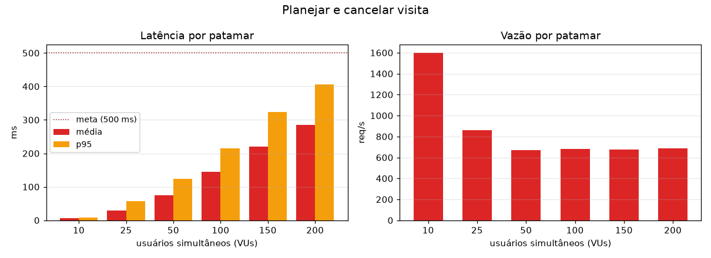
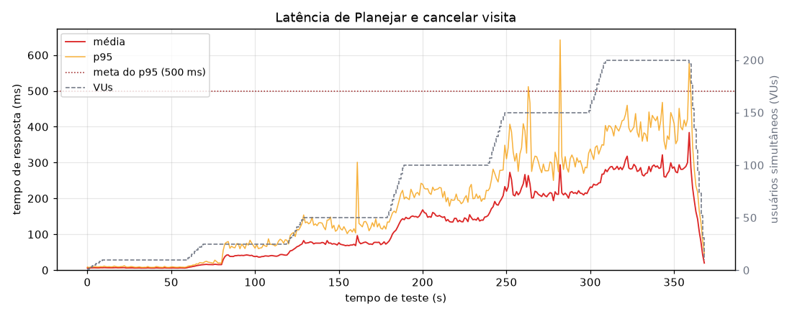
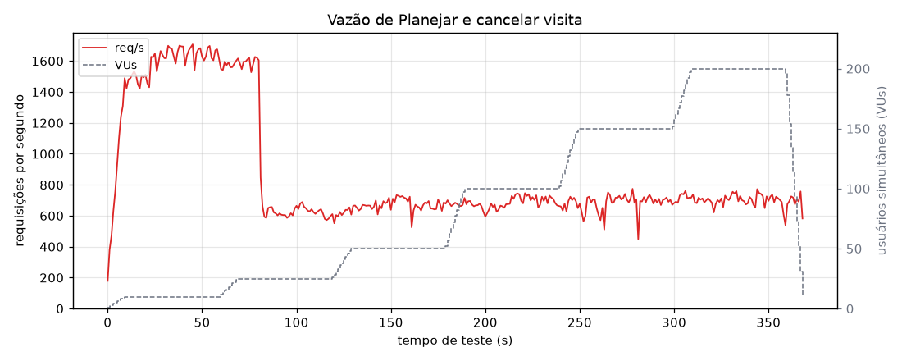
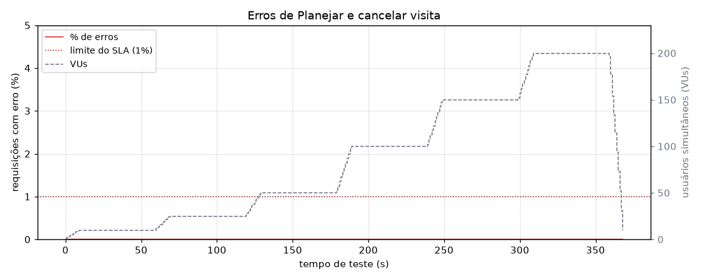
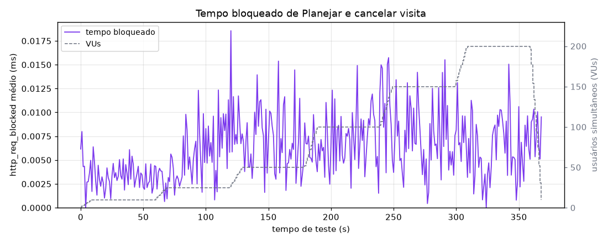

**Resumo dos números**

- De 10 para 200 VUs, a latência média foi de 6,22 ms para 284,98 ms, o p95 de 8,97 ms para 405,97 ms e a vazão de 1.597,7 para 688,7 req/s.
- A vazão foi máxima com 10 VUs (1.597,7 req/s) e depois caiu para 688,7 req/s com 200 VUs: além de fazer fila, o serviço ficou mais lento ao longo do teste (veja o gráfico de vazão no tempo).
- O SLA foi cumprido em todos os patamares.
- Nenhuma requisição falhou.
- Números completos: [`visitas-patamares.csv`](sla/medicao-1/visitas-patamares.csv) e [`visitas-por-segundo.csv`](sla/medicao-1/visitas-por-segundo.csv).
<!-- /MEDICAO1:visitas -->

#### Levantamento de hipóteses dos potenciais gargalos

- **O que a medição mostrou:** sem erros e dentro do SLA até 200 VUs, mas com pouca folga (p95 de 405,97 ms com 200 VUs, para uma meta de 500 ms;
  pela tendência, a meta seria estourada perto de 250 VUs). O comportamento mais importante está no gráfico de vazão no tempo: nos primeiros
  80 s o serviço atendia cerca de 1.600 req/s e, de repente, caiu para cerca de 650 req/s. A queda aconteceu no meio do patamar de 25 VUs,
  sem mudança no número de VUs, e a vazão ficou em torno de 680 req/s até 200 VUs. Ou seja, o limite não veio da concorrência, e sim de algo
  que se esgotou depois de cerca de 64 mil visitas gravadas. Por isso os números do patamar de 10 VUs não representam o serviço em regime.
- **Escrita no disco do MySQL:** o MySQL está com a configuração padrão do instalador (`my.ini`): `innodb_buffer_pool_size=128M`,
  `innodb_redo_log_capacity=100M`, `innodb_flush_log_at_trx_commit=1` e log binário ligado. Cada visita são duas transações (inserção e
  cancelamento), cada `INSERT` confere o índice único e duas chaves estrangeiras, e cada commit grava o log de transações e o log binário no disco. Enquanto o log de redo tem espaço, as escritas ficam na memória;
  quando ele enche (o que bate com a queda em 80 s), o MySQL passa a segurar novos commits até gravar as páginas alteradas no disco,
  e a vazão fica presa à velocidade do disco.
- **Pool de conexões pequeno:** o HikariCP usa 10 conexões por padrão e cada requisição abre uma transação (`@Transactional` em `VisitaService`).
  Com mais de 10 requisições simultâneas, as excedentes esperam conexão livre; como as transações ficam mais lentas depois que o disco vira
  o gargalo, a fila por conexão cresce junto.
- **Muitas consultas por escrita:** antes do `INSERT`, a requisição busca o mesmo usuário três vezes (duas no `JwtAuthFilter` e uma em
  `UsuarioService.buscarPorEmail`), cada uma carregando também as curtidas (`EAGER`), e ainda confere se a trilha existe e se a data está livre.
  O cancelamento repete a busca do usuário e faz `findById` antes do `UPDATE`. A maior parte do tempo é leitura, não escrita.
- **Busca por e-mail sem índice:** `UsuarioRepository.findByEmail` usa `findByEmailIgnoreCase`, que vira `upper(email) = upper(?)`.
  Com a função na coluna, o MySQL não usa o índice `UNIQUE` do e-mail e percorre a tabela `USUARIO` inteira em cada uma dessas buscas.
  Neste teste a tabela é pequena (cerca de 200 usuários), mas o custo cresce com o número de cadastros.
- **Verificar e depois inserir não é atômico:** `exigirDataLivre()` consulta e só depois insere. Sob concorrência, duas requisições iguais podem
  passar pela verificação e uma delas estoura o índice único com erro 500 em vez de 409 (neste teste as datas não se repetem).

### Medição 2

<!-- MEDICAO2:visitas -->
- **Data da medição:** 16/11/2026
- **Descrição das configurações:** computador local: AMD Ryzen 7 7800X3D 8-Core Processor, 16 núcleos lógicos, 32 GB de RAM, Microsoft Windows 10 Pro. Backend (Spring Boot), banco e gerador de carga na mesma máquina, sem containers (Java 25.0.3 · MySQL 8.0.45 · k6 v2.4.0). Detalhes em [Configuração do ambiente](#configuração-do-ambiente).

#### Testes de carga (SLA): latência, vazão e concorrência

- **Requisições no teste:** 336.248
- **Limite de concorrência dentro do SLA** (p95 ≤ 500 ms e erros < 1%): o SLA valeu em todos os patamares, até **200 VUs** (o limite real fica acima disso)

| Concorrência (VUs) | Requisições | Latência média (ms) | p95 (ms) | p99 (ms) | Vazão (req/s) | Erros (%) | SLA |
| ---: | ---: | ---: | ---: | ---: | ---: | ---: | :---: |
| 10 | 74.040 | 6,71 | 11,76 | 15,87 | 1.480,5 | 0,00 | ✅ |
| 25 | 37.376 | 33,20 | 48,86 | 68,79 | 747,3 | 0,00 | ✅ |
| 50 | 41.726 | 59,67 | 88,47 | 107,88 | 832,5 | 0,00 | ✅ |
| 100 | 42.262 | 118,09 | 182,71 | 227,62 | 839,3 | 0,00 | ✅ |
| 150 | 43.118 | 173,77 | 270,86 | 342,47 | 855,1 | 0,00 | ✅ |
| 200 | 41.898 | 238,42 | 382,75 | 486,50 | 830,5 | 0,00 | ✅ |

| Métrica (teste inteiro) | Média | Mediana | Mín | Máx | P95 | P99 |
| --- | ---: | ---: | ---: | ---: | ---: | ---: |
| Latência, `http_req_duration` (ms) | 95,29 | 63,84 | 2,15 | 903,21 | 260,71 | 366,34 |
| Tempo bloqueado, `http_req_blocked` (ms) | 0,01 | 0,00 | 0,00 | 3,47 | 0,00 | 0,00 |

Latência média por endpoint (ms):

| Concorrência (VUs) | `PATCH /api/visitas/{id}/cancelar` | `POST /api/visitas` |
| ---: | ---: | ---: |
| 10 | 6,81 | 6,60 |
| 25 | 31,92 | 34,47 |
| 50 | 57,84 | 61,50 |
| 100 | 114,57 | 121,61 |
| 150 | 169,06 | 178,49 |
| 200 | 232,17 | 244,67 |

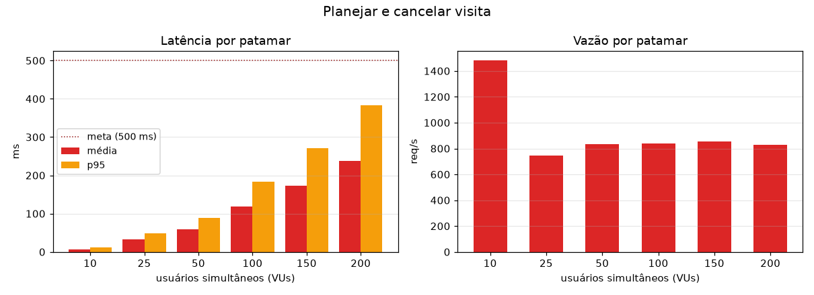
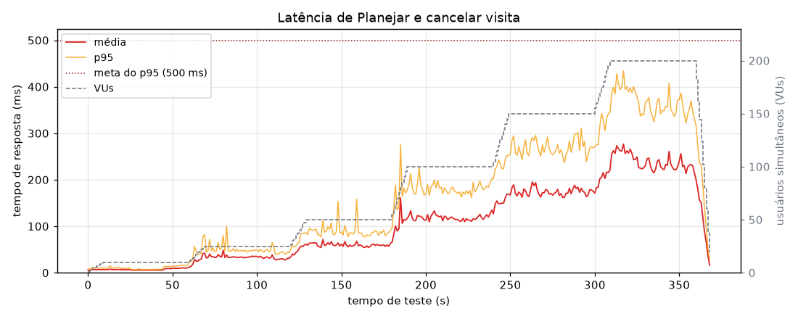
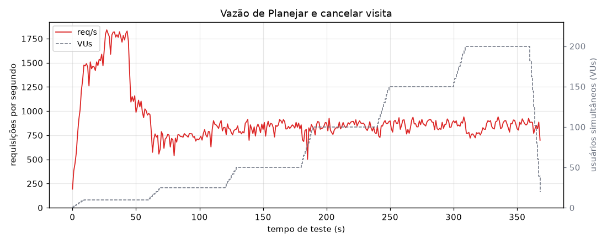
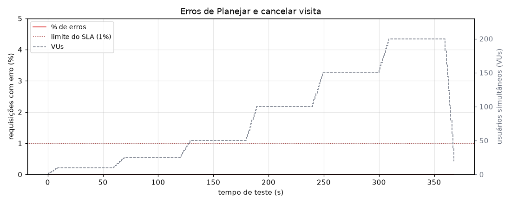
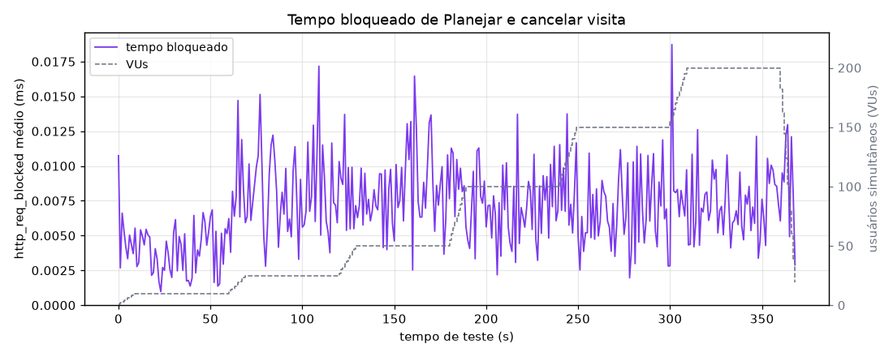

**Resumo dos números**

- De 10 para 200 VUs, a latência média foi de 6,71 ms para 238,42 ms, o p95 de 11,76 ms para 382,75 ms e a vazão de 1.480,5 para 830,5 req/s.
- A vazão foi máxima com 10 VUs (1.480,5 req/s) e depois caiu para 830,5 req/s com 200 VUs: além de fazer fila, o serviço ficou mais lento ao longo do teste (veja o gráfico de vazão no tempo).
- O SLA foi cumprido em todos os patamares.
- Nenhuma requisição falhou.
- Números completos: [`visitas-patamares.csv`](sla/medicao-2/visitas-patamares.csv) e [`visitas-por-segundo.csv`](sla/medicao-2/visitas-por-segundo.csv).
<!-- /MEDICAO2:visitas -->

<!-- COMPARACAO:visitas -->
| Concorrência (VUs) | Latência média 1 → 2 (ms) | p95 1 → 2 (ms) | Vazão 1 → 2 (req/s) | Erros 1 → 2 (%) |
| ---: | ---: | ---: | ---: | ---: |
| 10 | 6,22 → 6,71 (+7,9%) | 8,97 → 11,76 (+31,1%) | 1.597,7 → 1.480,5 (-7,3%) | 0,00 → 0,00 |
| 25 | 28,93 → 33,20 (+14,7%) | 56,98 → 48,86 (-14,3%) | 860,6 → 747,3 (-13,2%) | 0,00 → 0,00 |
| 50 | 74,51 → 59,67 (-19,9%) | 123,77 → 88,47 (-28,5%) | 668,8 → 832,5 (+24,5%) | 0,00 → 0,00 |
| 100 | 145,66 → 118,09 (-18,9%) | 215,17 → 182,71 (-15,1%) | 682,0 → 839,3 (+23,1%) | 0,00 → 0,00 |
| 150 | 219,51 → 173,77 (-20,8%) | 324,24 → 270,86 (-16,5%) | 678,6 → 855,1 (+26,0%) | 0,00 → 0,00 |
| 200 | 284,98 → 238,42 (-16,3%) | 405,97 → 382,75 (-5,7%) | 688,7 → 830,5 (+20,6%) | 0,00 → 0,00 |

- **Limite de concorrência dentro do SLA:** 200 VUs na medição 1 → 200 VUs na medição 2.
- **Latência média do teste inteiro:** 101,42 ms → 95,29 ms (-6,1%).

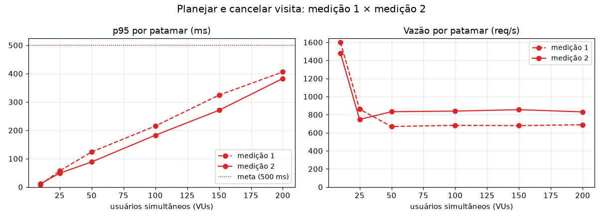
<!-- /COMPARACAO:visitas -->

**Melhorias/otimizações:**

- [`JwtAuthFilter.java`](../backend/src/main/java/br/com/ecoturismo/security/JwtAuthFilter.java): o token é validado com **uma** consulta que
  traz só id, e-mail, perfil e versão do token (sem as curtidas), em vez de buscar o usuário inteiro duas vezes.
- [`UsuarioRepository.java`](../backend/src/main/java/br/com/ecoturismo/usuario/UsuarioRepository.java): as buscas por e-mail comparam
  `email = ?` com o e-mail já em minúsculas, o que deixa o MySQL usar o índice `UNIQUE` (antes era `upper(email) = upper(?)`).
  Ganhou também as consultas leves `buscarCredenciais` (usada pelo filtro) e `buscarId` (só o id).
- [`UsuarioService.java`](../backend/src/main/java/br/com/ecoturismo/usuario/UsuarioService.java): novo `idPorEmail()`; as contas criadas
  na inicialização também passaram a gravar o e-mail em minúsculas, como no cadastro.
- [`VisitaService.java`](../backend/src/main/java/br/com/ecoturismo/visita/VisitaService.java): planejar e cancelar pegam só o id do usuário,
  a trilha é conferida no catálogo em memória e a consulta de "data livre" saiu: quem garante a regra é o próprio índice
  `UNIQUE (idUsuario, idTrilha, data)`, e a violação vira **409** com a mesma mensagem de antes. Isso tira uma consulta e fecha a brecha de
  duas requisições iguais passarem juntas pela conferência.
- [`VisitaRepository.java`](../backend/src/main/java/br/com/ecoturismo/visita/VisitaRepository.java): saiu o `existsByUsuarioIdAndTrilhaIdAndData`,
  que não é mais usado.
- [`TrilhaService.java`](../backend/src/main/java/br/com/ecoturismo/trilha/TrilhaService.java): `garantirQueExiste()` usa o catálogo em memória
  (ver o serviço 1).
- [`ajustes-mysql.sql`](../tests/k6/sla/ajustes-mysql.sql): para a escrita em disco, o MySQL rodou com `innodb_redo_log_capacity` de 100 MB
  para **1 GB** e `innodb_buffer_pool_size` de 128 MB para **1 GB** (o resto do `my.ini` igual). A durabilidade não mudou:
  `innodb_flush_log_at_trx_commit` continua 1, com cada commit gravado no disco.

Com isso, um `POST /api/visitas` passou de 5 consultas antes do `INSERT` (3 buscas do usuário com as curtidas, trilha e data livre)
para 2 leves (credenciais do token e id do usuário); o `PATCH .../cancelar` passou de 4 consultas antes do `UPDATE` para 3.

**O que a medição 2 mostrou:**

- Nos patamares de 50 a 200 VUs, já com o serviço em regime, a vazão subiu de cerca de 680 para cerca de **830 a 855 req/s** (+21% a +26%)
  e o p95 caiu em todos eles (com 50 VUs, de 123,77 para 88,47 ms; com 200 VUs, de 405,97 para 382,75 ms). Isso veio das consultas a menos.
- **A queda de vazão continuou.** Ela veio até mais cedo (cerca de 45 s, contra 80 s na medição 1), mesmo com 10 vezes mais redo log e buffer pool.
  Por isso os números de 10 e 25 VUs ficaram menores que na medição 1: na medição 2, parte do patamar de 10 VUs e todo o de 25 já caíram depois da queda.
  A hipótese de que a queda vinha do redo log cheio **não se confirmou**: aumentá-lo não adiou a queda.
- **Nova hipótese:** o limite é o próprio disco. Cada requisição é uma transação, e cada commit grava no disco, com sincronização (`fsync`),
  o redo log (`innodb_flush_log_at_trx_commit=1`) e o log binário (`sync_binlog=1`). No começo, o cache de escrita do Windows e do SSD
  aguenta o pico; quando ele enche, a vazão cai para o que o disco sustenta. Para confirmar, o próximo teste seria rodar uma vez com
  `innodb_flush_log_at_trx_commit=2` (sincroniza 1 vez por segundo e pode perder até 1 s de transações se a máquina cair) ou com o banco
  em outro disco ou em outra máquina.

---

## Serviço 3 · Login

- **Endpoint:** `POST /api/auth/login`
- **Tipo de operações:** leitura, com custo alto de CPU (busca o usuário pelo e-mail, confere a senha com BCrypt e gera um token JWT).
  Todos os VUs usam a conta de teste da Marina, criada pelo `DataSeeder`.
- **Arquivos envolvidos:**
  [`AuthController.java`](../backend/src/main/java/br/com/ecoturismo/security/AuthController.java) ·
  [`SecurityConfig.java`](../backend/src/main/java/br/com/ecoturismo/security/SecurityConfig.java) ·
  [`UsuarioDetailsService.java`](../backend/src/main/java/br/com/ecoturismo/security/UsuarioDetailsService.java) ·
  [`JwtService.java`](../backend/src/main/java/br/com/ecoturismo/security/JwtService.java) ·
  [`LoginRequest.java`](../backend/src/main/java/br/com/ecoturismo/security/dto/LoginRequest.java) ·
  [`AuthResponse.java`](../backend/src/main/java/br/com/ecoturismo/security/dto/AuthResponse.java) ·
  [`UsuarioService.java`](../backend/src/main/java/br/com/ecoturismo/usuario/UsuarioService.java) ·
  [`Usuario.java`](../backend/src/main/java/br/com/ecoturismo/usuario/Usuario.java) ·
  [`DataSeeder.java`](../backend/src/main/java/br/com/ecoturismo/config/DataSeeder.java) ·
  [`V1__criar_tabelas.sql`](../backend/src/main/resources/db/migration/V1__criar_tabelas.sql) (tabela `USUARIO`)
- **Arquivos com o código fonte de medição do SLA:**
  [`login.js`](../tests/k6/sla/login.js) ·
  [`degraus.js`](../tests/k6/sla/lib/degraus.js) ·
  [`graficos.py`](../tests/k6/sla/graficos.py) ·
  [`rodar-testes.bat`](../tests/k6/sla/rodar-testes.bat) ·
  [`sla-k6.yml`](../.github/workflows/sla-k6.yml)

### Medição 1

<!-- MEDICAO1:login -->
- **Data da medição:** 16/11/2026
- **Descrição das configurações:** computador local: AMD Ryzen 7 7800X3D 8-Core Processor, 16 núcleos lógicos, 32 GB de RAM, Microsoft Windows 10 Pro. Backend (Spring Boot), banco e gerador de carga na mesma máquina, sem containers (Java 25.0.3 · MySQL 8.0.45 · k6 v2.4.0). Detalhes em [Configuração do ambiente](#configuração-do-ambiente).

#### Testes de carga (SLA): latência, vazão e concorrência

- **Requisições no teste:** 73.127
- **Limite de concorrência dentro do SLA** (p95 ≤ 1000 ms e erros < 1%): **100 VUs** (com 150 VUs o SLA deixou de valer)

| Concorrência (VUs) | Requisições | Latência média (ms) | p95 (ms) | p99 (ms) | Vazão (req/s) | Erros (%) | SLA |
| ---: | ---: | ---: | ---: | ---: | ---: | ---: | :---: |
| 10 | 7.782 | 64,15 | 68,72 | 76,75 | 155,6 | 0,00 | ✅ |
| 25 | 10.358 | 119,42 | 215,59 | 319,21 | 206,8 | 0,00 | ✅ |
| 50 | 10.391 | 236,02 | 470,16 | 664,07 | 207,6 | 0,00 | ✅ |
| 100 | 10.432 | 469,43 | 835,64 | 1.065,99 | 206,2 | 0,00 | ✅ |
| 150 | 10.455 | 670,16 | 1.224,85 | 1.606,37 | 206,8 | 0,00 | ❌ |
| 200 | 10.468 | 871,74 | 1.586,13 | 2.633,50 | 198,8 | 0,00 | ❌ |

| Métrica (teste inteiro) | Média | Mediana | Mín | Máx | P95 | P99 |
| --- | ---: | ---: | ---: | ---: | ---: | ---: |
| Latência, `http_req_duration` (ms) | 412,87 | 286,62 | 53,56 | 4.961,38 | 1.120,93 | 1.586,05 |
| Tempo bloqueado, `http_req_blocked` (ms) | 0,76 | 0,00 | 0,00 | 2.685,95 | 0,00 | 1,00 |

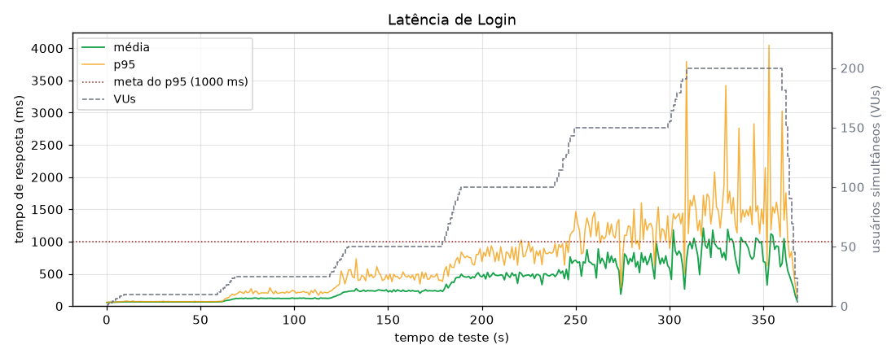
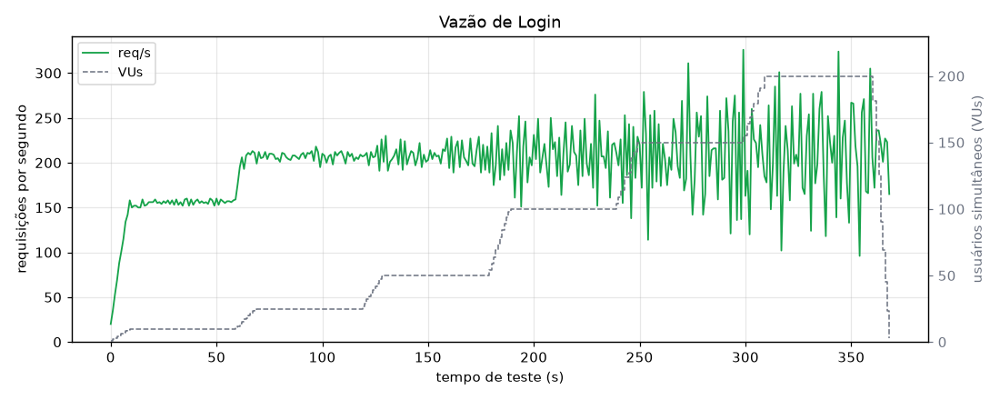
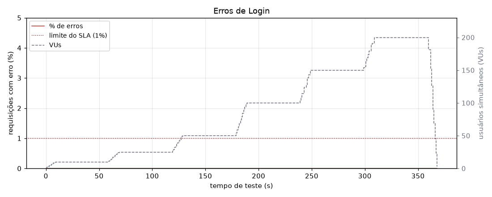
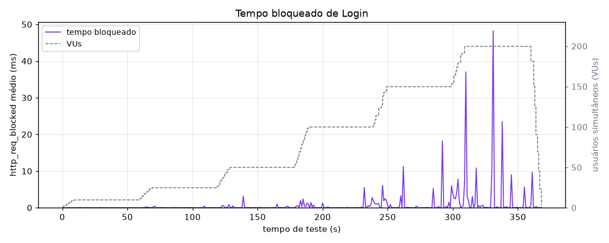

**Resumo dos números**

- De 10 para 200 VUs, a latência média foi de 64,15 ms para 871,74 ms, o p95 de 68,72 ms para 1.586,13 ms e a vazão de 155,6 para 198,8 req/s.
- A vazão chegou a 90% do máximo (207,6 req/s) já com 25 VUs. Daí em diante, mais usuários só aumentaram o tempo de espera: algum recurso (CPU, conexões com o banco ou threads) está no limite e as requisições fazem fila.
- O SLA deixou de valer com 150 VUs (p95 de 1.224,85 ms).
- Nenhuma requisição falhou.
- Números completos: [`login-patamares.csv`](sla/medicao-1/login-patamares.csv) e [`login-por-segundo.csv`](sla/medicao-1/login-por-segundo.csv).
<!-- /MEDICAO1:login -->

#### Levantamento de hipóteses dos potenciais gargalos

- **O que a medição mostrou:** é o único serviço que quebrou o SLA. Sem erros em nenhum patamar, mas o p95 passou de 1000 ms com 150 VUs
  (1.224,85 ms), então o limite de concorrência dentro do SLA é **100 VUs**. Com 10 VUs cada login levou 64 ms e a vazão foi de 155,6 req/s
  (10 ÷ 0,064 s). A partir de 25 VUs a vazão parou em cerca de 207 req/s e a latência passou a crescer junto com os VUs. Acima de 100 VUs
  a vazão segundo a segundo fica muito instável (entre 100 e 320 req/s) e até o tempo bloqueado do k6 sobe (de 0,01 ms para 1,94 ms em média):
  sinal de que a CPU da máquina inteira estava no limite.
- **BCrypt limita a vazão:** `SecurityConfig` usa `new BCryptPasswordEncoder()` (custo 10), e cada login gasta dezenas de milissegundos de CPU
  de propósito, para dificultar ataques de força bruta. A vazão máxima fica perto de *(núcleos) ÷ (tempo de um login)*: com 16 núcleos lógicos
  e 64 ms por login (o tempo medido com 10 VUs, quando ainda sobrava CPU), o teto teórico seria 16 ÷ 0,064 ≈ 250 req/s. O medido foi 207 req/s,
  cerca de 83% disso; o resto da CPU foi para o k6 e o MySQL, que rodam na mesma máquina. Acima desse ponto, mais VUs só aumentam a fila.
- **Threads do Tomcat ocupadas:** cada login prende uma thread enquanto calcula o BCrypt; com muitos VUs, as requisições novas esperam.
- **Usuário carregado duas vezes:** `UsuarioDetailsService` busca o usuário para o Spring Security e o `AuthController` busca de novo para montar
  a resposta, cada vez com as curtidas (`EAGER`). É pouco perto do BCrypt, mas soma consultas.
- **Busca por e-mail sem índice:** as duas buscas usam `findByEmailIgnoreCase` (`upper(email) = upper(?)`), que impede o MySQL de usar
  o índice `UNIQUE` do e-mail; o custo cresce com o número de usuários cadastrados.
- **Disputa de CPU com o k6:** como o gargalo é CPU, o k6 rodando na mesma máquina tira processamento do backend.

### Medição 2

<!-- MEDICAO2:login -->
- **Data da medição:** 16/11/2026
- **Descrição das configurações:** computador local: AMD Ryzen 7 7800X3D 8-Core Processor, 16 núcleos lógicos, 32 GB de RAM, Microsoft Windows 10 Pro. Backend (Spring Boot), banco e gerador de carga na mesma máquina, sem containers (Java 25.0.3 · MySQL 8.0.45 · k6 v2.4.0). Detalhes em [Configuração do ambiente](#configuração-do-ambiente).

#### Testes de carga (SLA): latência, vazão e concorrência

- **Requisições no teste:** 74.689
- **Limite de concorrência dentro do SLA** (p95 ≤ 1000 ms e erros < 1%): **100 VUs** (com 150 VUs o SLA deixou de valer)

| Concorrência (VUs) | Requisições | Latência média (ms) | p95 (ms) | p99 (ms) | Vazão (req/s) | Erros (%) | SLA |
| ---: | ---: | ---: | ---: | ---: | ---: | ---: | :---: |
| 10 | 7.989 | 62,50 | 67,85 | 72,46 | 159,8 | 0,00 | ✅ |
| 25 | 10.685 | 115,51 | 221,17 | 317,72 | 213,3 | 0,00 | ✅ |
| 50 | 10.636 | 233,15 | 461,90 | 628,92 | 211,0 | 0,00 | ✅ |
| 100 | 10.821 | 451,03 | 800,29 | 1.021,36 | 214,2 | 0,00 | ✅ |
| 150 | 10.664 | 671,66 | 1.188,73 | 1.606,41 | 206,6 | 0,00 | ❌ |
| 200 | 10.451 | 880,44 | 1.667,83 | 2.343,72 | 206,7 | 0,00 | ❌ |

| Métrica (teste inteiro) | Média | Mediana | Mín | Máx | P95 | P99 |
| --- | ---: | ---: | ---: | ---: | ---: | ---: |
| Latência, `http_req_duration` (ms) | 408,92 | 281,63 | 52,51 | 4.209,74 | 1.146,64 | 1.626,23 |
| Tempo bloqueado, `http_req_blocked` (ms) | 0,48 | 0,00 | 0,00 | 2.468,82 | 0,00 | 0,51 |

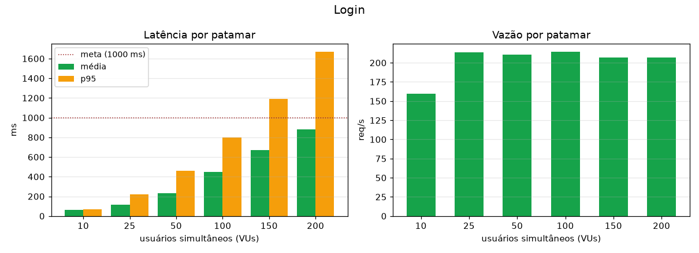
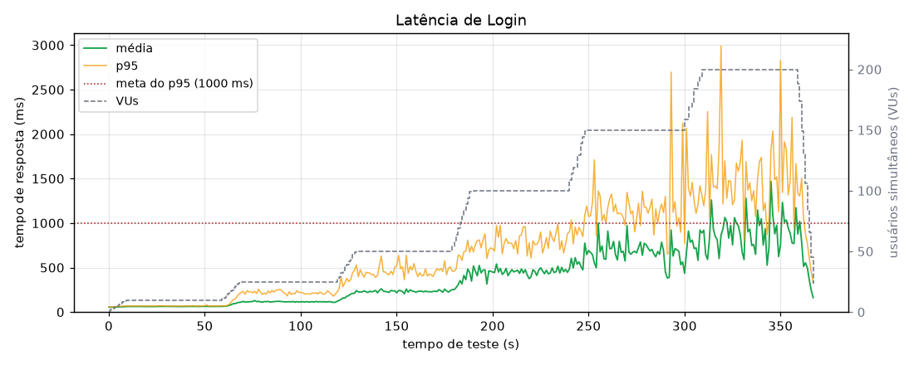
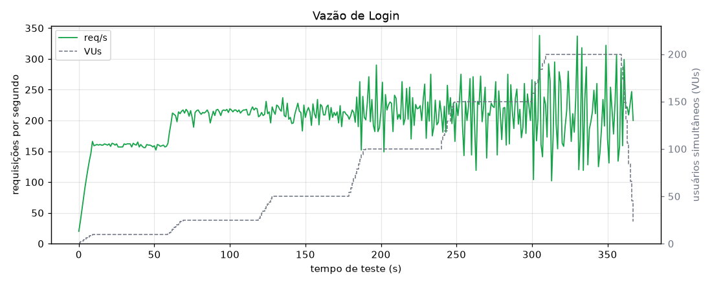

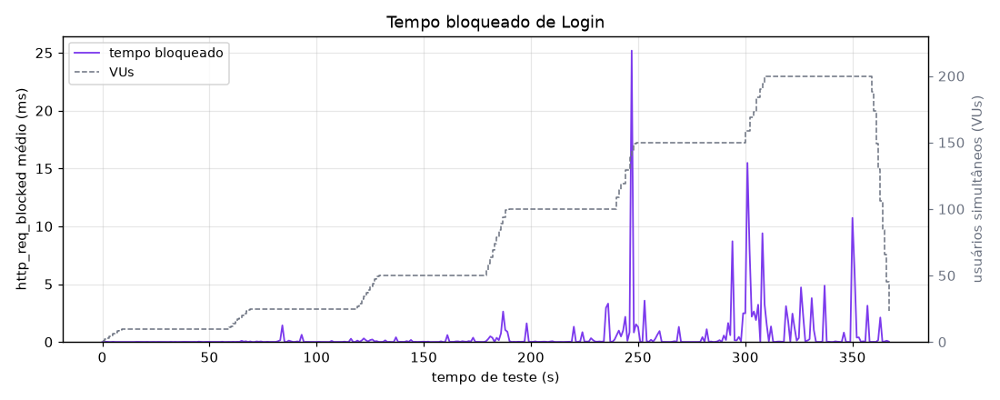

**Resumo dos números**

- De 10 para 200 VUs, a latência média foi de 62,50 ms para 880,44 ms, o p95 de 67,85 ms para 1.667,83 ms e a vazão de 159,8 para 206,7 req/s.
- A vazão chegou a 90% do máximo (214,2 req/s) já com 25 VUs. Daí em diante, mais usuários só aumentaram o tempo de espera: algum recurso (CPU, conexões com o banco ou threads) está no limite e as requisições fazem fila.
- O SLA deixou de valer com 150 VUs (p95 de 1.188,73 ms).
- Nenhuma requisição falhou.
- Números completos: [`login-patamares.csv`](sla/medicao-2/login-patamares.csv) e [`login-por-segundo.csv`](sla/medicao-2/login-por-segundo.csv).
<!-- /MEDICAO2:login -->

<!-- COMPARACAO:login -->
| Concorrência (VUs) | Latência média 1 → 2 (ms) | p95 1 → 2 (ms) | Vazão 1 → 2 (req/s) | Erros 1 → 2 (%) |
| ---: | ---: | ---: | ---: | ---: |
| 10 | 64,15 → 62,50 (-2,6%) | 68,72 → 67,85 (-1,3%) | 155,6 → 159,8 (+2,7%) | 0,00 → 0,00 |
| 25 | 119,42 → 115,51 (-3,3%) | 215,59 → 221,17 (+2,6%) | 206,8 → 213,3 (+3,1%) | 0,00 → 0,00 |
| 50 | 236,02 → 233,15 (-1,2%) | 470,16 → 461,90 (-1,8%) | 207,6 → 211,0 (+1,6%) | 0,00 → 0,00 |
| 100 | 469,43 → 451,03 (-3,9%) | 835,64 → 800,29 (-4,2%) | 206,2 → 214,2 (+3,9%) | 0,00 → 0,00 |
| 150 | 670,16 → 671,66 (+0,2%) | 1.224,85 → 1.188,73 (-2,9%) | 206,8 → 206,6 (-0,1%) | 0,00 → 0,00 |
| 200 | 871,74 → 880,44 (+1,0%) | 1.586,13 → 1.667,83 (+5,2%) | 198,8 → 206,7 (+4,0%) | 0,00 → 0,00 |

- **Limite de concorrência dentro do SLA:** 100 VUs na medição 1 → 100 VUs na medição 2.
- **Latência média do teste inteiro:** 412,87 ms → 408,92 ms (-1,0%).

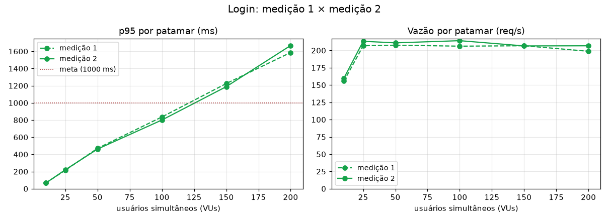
<!-- /COMPARACAO:login -->

**Melhorias/otimizações:**

- [`UsuarioDetailsService.java`](../backend/src/main/java/br/com/ecoturismo/security/UsuarioDetailsService.java): o `UserDetails` devolvido
  para o Spring Security (`UsuarioAutenticado`) guarda o usuário já carregado.
- [`AuthController.java`](../backend/src/main/java/br/com/ecoturismo/security/AuthController.java): depois de conferir a senha, a resposta é
  montada com esse mesmo usuário, sem a segunda busca no banco.
- [`UsuarioRepository.java`](../backend/src/main/java/br/com/ecoturismo/usuario/UsuarioRepository.java): busca por e-mail que usa o índice
  `UNIQUE` (ver o serviço 2).
- **O que não mudou, de propósito:** o custo do BCrypt (10). Diminuir o custo aumentaria a vazão, mas deixaria as senhas mais fáceis de quebrar
  por força bruta; o tempo do login é uma escolha de segurança, não um defeito.

**O que a medição 2 mostrou:**

- Praticamente igual à medição 1, como esperado: a vazão máxima foi de 207,6 para 214,2 req/s (+3%), o p95 com 100 VUs de 835,64 para 800,29 ms,
  e o limite de concorrência dentro do SLA continuou em **100 VUs** (com 150 VUs, p95 de 1.188,73 ms).
- Isso confirma a hipótese principal: o tempo do login é quase todo do BCrypt, e tirar uma consulta ao banco mexe pouco.
  Para atender mais logins simultâneos, o caminho seria mais CPU (ou mais instâncias do backend atrás de um balanceador), não otimizar o código.

---

## Comparação entre os serviços

### Medição 1

<!-- SERVICOS:1 -->
| Serviço | Requisições | Latência média (ms) | p95 (ms) | Vazão máxima (req/s) | Limite de concorrência no SLA | Erros (%) |
| --- | ---: | ---: | ---: | ---: | ---: | ---: |
| Busca no catálogo de trilhas | 430.139 | 74,42 | 166,16 | 1.194,7 (com 50 VUs) | 200 VUs | 0,00 |
| Planejar e cancelar visita | 316.330 | 101,42 | 303,42 | 1.597,7 (com 10 VUs) | 200 VUs | 0,00 |
| Login | 73.127 | 412,87 | 1.120,93 | 207,6 (com 50 VUs) | 100 VUs | 0,00 |

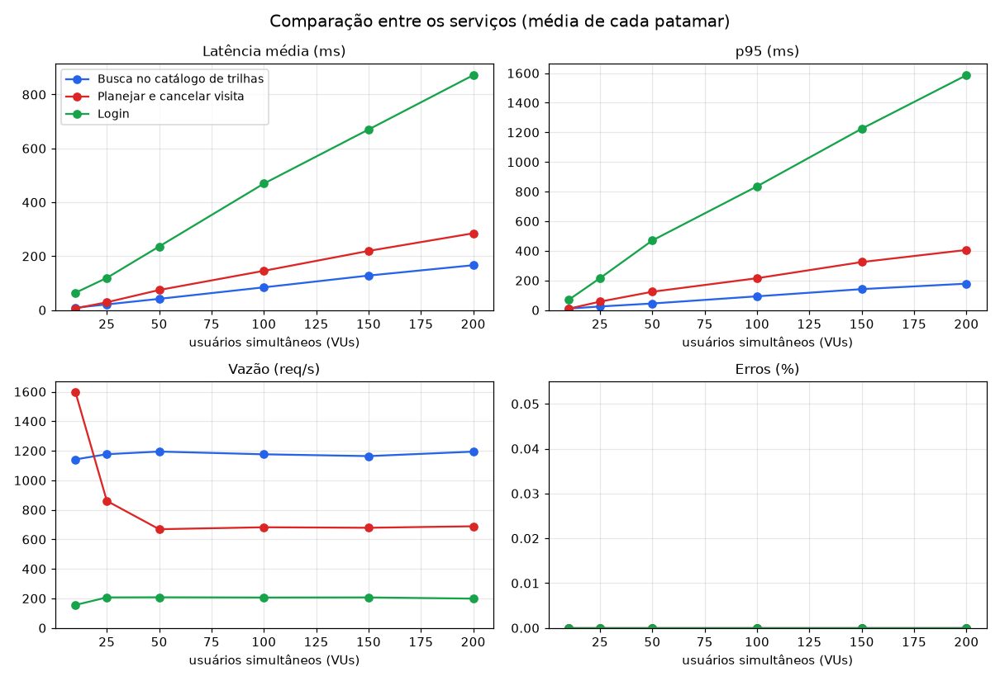
<!-- /SERVICOS:1 -->

### Medição 2

<!-- SERVICOS:2 -->
| Serviço | Requisições | Latência média (ms) | p95 (ms) | Vazão máxima (req/s) | Limite de concorrência no SLA | Erros (%) |
| --- | ---: | ---: | ---: | ---: | ---: | ---: |
| Busca no catálogo de trilhas | 14.294.816 | 1,75 | 5,50 | 44.749,2 (com 50 VUs) | 200 VUs | 0,00 |
| Planejar e cancelar visita | 336.248 | 95,29 | 260,71 | 1.480,5 (com 10 VUs) | 200 VUs | 0,00 |
| Login | 74.689 | 408,92 | 1.146,64 | 214,2 (com 100 VUs) | 100 VUs | 0,00 |

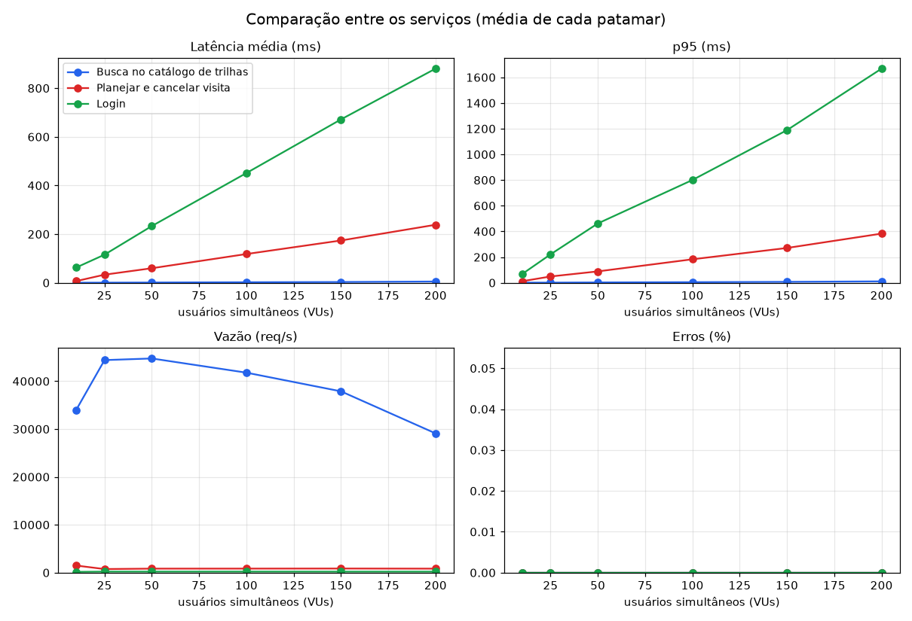
<!-- /SERVICOS:2 -->

---

## Como rodar

Precisa de Java 17 ou mais novo, MySQL 8, do k6 e do Python com o matplotlib. No Windows, uma vez só:
`winget install k6 --source winget`, `winget install Python.Python.3.12` e, num terminal novo, `pip install matplotlib`.

1. Suba o backend na raiz do projeto: `npm run back` (ou `cd backend && mvnw spring-boot:run`). As contas de teste precisam existir:
   elas são criadas na inicialização quando `app.teste.email` está preenchido em `application.properties`.
2. Dois cliques em `tests\k6\sla\rodar-testes.bat` (medição 1). Para a medição 2, aplique antes os ajustes do MySQL como root
   (`mysql -u root -p < tests\k6\sla\ajustes-mysql.sql`; valem até o MySQL reiniciar) e, no terminal, na raiz do projeto: `tests\k6\sla\rodar-testes.bat 2`.
   No fim ele chama o `graficos.py`, que gera os gráficos em `docs\sla\medicao-N` e preenche esta página.
3. O teste de visitas grava no banco (200 usuários e milhares de visitas). Para apagar esses dados depois:
   `mysql -u ecoturismo -p ecoturismo < tests\k6\sla\limpar-dados-de-carga.sql`.

Sem Windows, ou para rodar no GitHub: aba **Actions** → **Medições de SLA (k6)** → **Run workflow**, escolhendo a medição.
Ao terminar, baixe o artefato **sla-pagina** e suba a pasta `docs` para o repositório.

Para um teste rápido (não serve para a entrega): `set DEGRAUS=5,10,20` e `set PATAMAR=20` antes de rodar o `.bat`.
Os CSVs brutos do k6 (`sla-saida\`) são grandes e não vão para o repositório; os números por patamar e por segundo ficam em `docs\sla\medicao-N\`.
